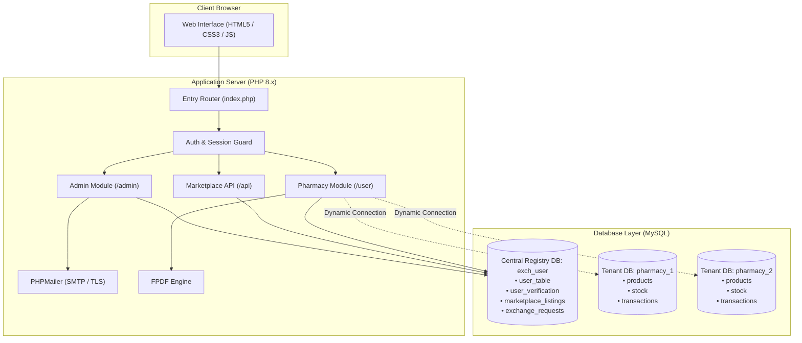

# 💊 EXPIROCHAIN

> **Medicine Lifecycle | Expiry Management | Waste Rescue & Compliance Platform**

[](https://www.php.net/)
[](https://www.mysql.com/)
[](LICENSE)
[]()

---

## 📌 1. Project Overview

**EXPIROCHAIN** is a full-stack web application designed for pharmacies, hospital dispensaries, stockists, and healthcare distributors to streamline medicine inventory control, track batch-level expiration dates, mitigate pharmaceutical financial loss, and facilitate B2B stock rescue and exchange.

By incorporating a **multi-tenant per-pharmacy database architecture** alongside a **centralized compliance and marketplace exchange registry**, EXPIROCHAIN guarantees tenant data isolation while empowering organizations to trade near-expiry medicines before they become toxic waste.

---

## 🛑 2. Problem Statement

Every year, billions of dollars worth of viable medicines expire on pharmacy shelves and are incinerated, creating severe financial loss and environmental hazards. At the same time, neighboring clinics often experience critical shortages of the very same pharmaceuticals.

Traditional retail management systems:
- Lack proactive notification cycles for batches nearing expiry (30, 60, 90-day warning tiers).
- Offer no compliant B2B marketplace channel to liquidate or exchange stock.
- Lack regulatory audit verification (GST and Drug License validation) before permitting organizations to trade pharmaceuticals.

---

## 🎯 3. Project Objectives

- **Mitigate Medicine Wastage:** Enable timely liquidation of expiring batches through an inter-pharmacy exchange network.
- **Ensure Regulatory Compliance:** Require verified Drug License (Form 20B/21B) and GST documentation before approving tenant registration.
- **Strict Tenant Isolation:** Provide dynamic tenant database provisioning for each approved organization.
- **Actionable Inventory Analytics:** Provide automated visual dashboards categorizing products by expiry status, valuation, and category.
- **Automated Verification Workflows:** Integrate SMTP-based Email OTP verification for onboarding and credential recovery.

---

## 🚀 4. Key Features

### 🏢 1. Organization & Multi-Tenant Management
- Self-service pharmacy registration with contact details and premises credentials.
- Dual Drug License (`dl1`, `dl2`) and GST document proof upload pipeline.
- Central administrative review panel for verification, approval, or rejection with remarks.
- Dynamic automated creation of isolated tenant databases (`sample_pharmacy_1`, etc.) upon administrative approval.

### 📦 2. Batch-Level Medicine Inventory
- Granular tracking by Batch Number, Expiry Date, Purchase Rate, MRP, and Stock Quantity.
- Categorization across Tablets, Syrups, Injections, Ointments, Drops, and Medical Devices.
- Automatic inventory status classification: **Valid**, **Near Expiry (<90 days)**, and **Expired**.

### 🔄 3. B2B Medicine Waste Rescue Marketplace
- Publish near-expiry batches to the unified inter-firm marketplace.
- Browse active listings from other licensed pharmacies.
- Counter-request workflow: send exchange/purchase requests with custom quantities and negotiated rates.
- Status tracking: Pending, Approved, Rejected, and Withdrawn requests.

### 📊 5. Visual Dashboard & Reports
- Real-time KPI summaries: Total Products, Total Stock Units, Near Expiry Alerts, and Expired Batches.
- Interactive Chart.js visual distribution of stock by category.
- FPDF-powered printable PDF inventory audits and stock report downloads.

### 🔐 6. Enterprise-Grade Security
- Cryptographic password hashing with backward-compatible legacy support (`password_hash` / `password_verify`).
- Sanitized SQL queries using `mysqli_real_escape_string()` and strict numerical casting (`intval()`, `floatval()`).
- Session access control on all admin and pharmacy management views.
- Secure file upload validation with MIME and extension whitelisting (`pdf`, `jpg`, `png`).

---

## 🛠️ 5. Technologies Used

| Layer | Technologies |
|---|---|
| **Frontend** | HTML5, CSS3, JavaScript (Vanilla ES6), FontAwesome Icons |
| **Data Visualization** | Chart.js 3.x |
| **Backend** | Core PHP 8.x (Object-Oriented & Procedural Modules) |
| **Database** | MySQL 8.0 / MariaDB (Multi-database architecture with foreign keys) |
| **Email Protocol** | PHPMailer via TLS/SMTP (Google Gmail SMTP) |
| **PDF Engine** | FPDF 1.8x |
| **Local Environment** | XAMPP / PHP Built-in Server |

---

## 🏗️ 6. System Architecture



---

## 📂 7. Project Folder Structure

```text
EXPIROCHAIN/
├── admin/                     # Administrative verification and control center
│   ├── css/                   # Admin UI stylesheets
│   ├── admin_usr.php          # Registered user management
│   ├── admin_vrf.php          # Pending pharmacy document verification
│   ├── edit_user.php          # User credential editor
│   ├── index.php              # Admin root router
│   └── update_user.php        # Approval/rejection controller with tenant DB generation
├── api/                       # API backend endpoints
│   ├── get_marketplace.php    # Active exchange listings
│   ├── login_api.php          # API authentication controller
│   ├── manage_request.php     # Exchange request approval/rejection
│   ├── send_request.php       # Dispatch exchange request
│   └── withdraw_request.php   # Cancel pending request
├── css/                       # Core application stylesheets
│   ├── dashboard.css          # Portal UI design
│   ├── login.css              # Authentication view styling
│   └── register.css           # Multi-step registration styles
├── database/                  # Schema specifications and data dictionaries
│   ├── README.md              # Database architectural documentation
│   └── schema.sql             # SQL schema definitions & sample seed data
├── fpdf/                      # FPDF PDF generation library
├── images/                    # UI branding, icons, and graphic assets
├── js/                        # Client-side scripts and Chart.js integration
├── PHPMailer/                 # PHPMailer email transmission library
├── uploads/                   # Secure storage for verified licenses and GST proof
├── temp_uploads/              # Temporary file cache during registration
├── user/                      # Tenant pharmacy portal
│   ├── add_product.php        # Register new medicine master
│   ├── add_stock.php          # Record batch, quantity, and expiry date
│   ├── dashboard.php          # Pharmacy KPI metrics and charts
│   ├── download_report.php    # FPDF export engine
│   ├── index.php              # Tenant redirection entry
│   ├── layout.php             # Unified navigation header and sidebar
│   ├── marketplace.php        # B2B medicine rescue portal
│   ├── my_requests.php        # Outgoing exchange tracking
│   ├── receive_requests.php   # Incoming exchange approvals
│   ├── save_product.php       # Product persistence controller
│   ├── save_stock.php         # Stock entry controller
│   ├── stock_table.php        # Master inventory ledger
│   └── view_product.php       # Product catalogue
├── .gitignore                 # Excluded files (credentials, temp uploads)
├── config.example.php         # Template configuration file for development
├── CONTRIBUTING.md            # Guidelines for open-source contributions
├── dbconnect.php              # Centralized PDO/mysqli database initialization
├── index.php                  # Root application router
├── LICENSE                    # MIT Open Source License
├── login.php                  # User & Admin authentication portal
├── login_process.php          # Authentication controller
├── logout.php                 # Session termination controller
├── README.md                  # Comprehensive project documentation
├── register.php               # Pharmacy registration portal
├── reset_password.php         # Password update handler
├── save_user.php              # Registration data persistence
├── send_otp.php               # Multi-step verification OTP dispatcher
├── start-server.bat           # One-click Windows PHP local launcher
└── verify_otp.php             # Registration OTP confirmation
```

---

## 🗄️ 8. Database Architecture & Setup

The system utilizes an advanced **dynamic multi-database model**:
1. **`exch_user` (Central Hub):** Manages user authentication, verification files, and the cross-pharmacy marketplace exchange.
2. **`sample_pharmacy_1` (Tenant Store):** Manages local inventory, batches, and transactions for each distinct approved organization.

### Quick Database Import

Using MySQL CLI:
```bash
mysql -u root -p < database/schema.sql
```

Or via **phpMyAdmin**:
1. Open `http://localhost/phpmyadmin/`.
2. Click **Import**.
3. Select `database/schema.sql` and click **Execute**.

> Full database entity definitions, ER diagrams, and relationship models can be reviewed in [database/README.md](database/README.md).

---

## ⚙️ 9. Installation & Configuration

### Prerequisites
- PHP 8.0 or higher with `mysqli`, `openssl`, `curl`, `mbstring`, and `fileinfo` extensions enabled.
- MySQL 8.0 or MariaDB 10.4+.
- Web server: Apache (via XAMPP) or PHP Built-in Server.

### Step 1: Clone Repository
```bash
git clone https://github.com/SumitPrajapati03/Expirochain.git
cd Expirochain
```

### Step 2: Configure Environment Credentials
Copy the example configuration to create your local private configuration:
```bash
# Windows PowerShell
Copy-Item config.example.php config.php

# Linux / macOS
cp config.example.php config.php
```

Edit `config.php` with your local database credentials:
```php
define("DB_HOST", "localhost");
define("DB_USER", "root");
define("DB_PASS", "your_mysql_password");
define("DB_NAME", "exch_user");
```

---

## ✉️ 10. Email & SMTP Configuration

To enable automated OTP verification for registrations and password resets, configure your SMTP credentials in `config.php`:

```php
define("SMTP_HOST", "smtp.gmail.com");
define("SMTP_PORT", 587);
define("SMTP_SECURE", "tls");
define("SMTP_USER", "your-email@gmail.com");
define("SMTP_PASS", "your-16-char-google-app-password");
```

> **Note on Gmail:** You must generate a 16-character **Google App Password** under your Google Account's **Security > 2-Step Verification** settings. Never commit your real credentials to Git.

---

## 💻 11. How to Run Locally

### Option A: Using the One-Click Windows Script (Easiest)
Double-click `start-server.bat` in the project root, or execute:
```cmd
start-server.bat
```
Navigate to: **`http://localhost:8000`**

### Option B: Using PHP Built-In Server
```bash
php -S localhost:8000
```
Navigate to: **`http://localhost:8000`**

### Option C: Using XAMPP
1. Move the `Expirochain` folder into `C:/xampp/htdocs/`.
2. Start **Apache** and **MySQL** from the XAMPP Control Panel.
3. Open your browser and navigate to: **`http://localhost/Expirochain`**

---

## 🔑 12. Default Demo Credentials

| Role | Username / Identifier | Password | Access Level |
|---|---|---|---|
| **System Admin** | `admin` | `exp123` | Administrative verification & user control |
| **Demo Pharmacy** | `9876543210` | `password123` | Inventory, stock tracking, & marketplace |

---

## 📸 13. Screenshots

| Authentication & Verification | Pharmacy Dashboard |
|:---:|:---:|
| *(Add login screenshot here)* | *(Add dashboard KPI screenshot here)* |

| Master Stock Ledger | Waste Rescue Marketplace |
|:---:|:---:|
| *(Add stock table screenshot here)* | *(Add marketplace exchange screenshot here)* |

---

## 🔮 14. Future Roadmap

- [ ] **Blockchain Integration:** Smart-contract ledger for tamper-proof batch disposal verification.
- [ ] **Barcode & GS1 2D DataMatrix Scanning:** Direct webcam/camera scanning for rapid batch entry.
- [ ] **Automated WhatsApp / SMS Alerts:** Real-time push alerts 30 days prior to batch expiration.
- [ ] **Reverse Logistics Integration:** One-click courier booking for marketplace stock exchanges.
- [ ] **RESTful Mobile API:** Flutter mobile application for pharmacy storekeepers.

---

## 👥 15. Contributors

- **Sumit Prajapati** - *Lead Developer & Architect* - [GitHub Profile](https://github.com/SumitPrajapati03)

---

## 📄 16. License

This project is open-source and licensed under the [MIT License](LICENSE).
