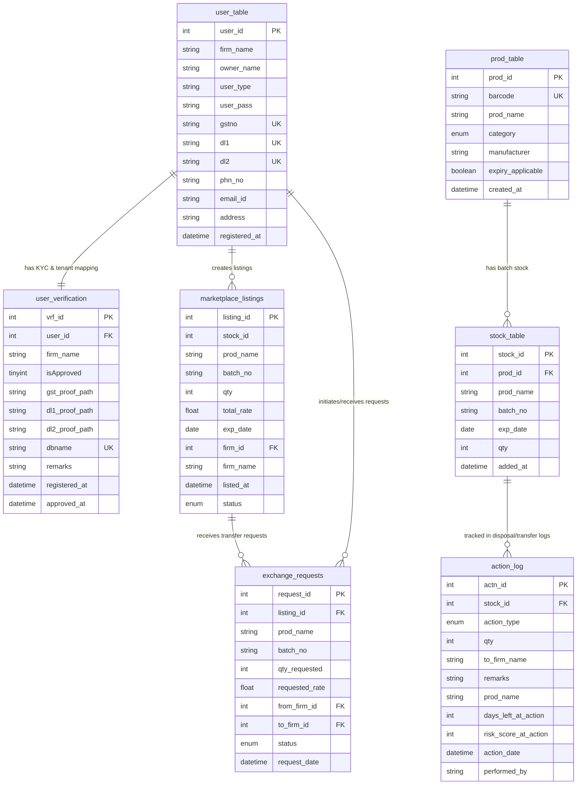

# 🗄️ EXPIROCHAIN - Database Documentation

This document describes the database architecture, schema definitions, multi-tenant database provisioning, and setup instructions for **EXPIROCHAIN**.

---

## 🏗️ Architecture Overview

EXPIROCHAIN employs a **Multi-Tenant Hybrid Model**:
1. **Central Database (`exch_user`)**: Manages centralized platform functions including user registrations, KYC drug license verification, cross-organizational marketplace listings, and inter-firm medicine exchange requests.
2. **Tenant Databases (`<firm_slug>_<user_id>`)**: Each registered firm (Pharmacy, Hospital, Clinic, or NGO) receives an isolated, independent database provisioned dynamically upon administrator verification. This guarantees tenant data isolation for proprietary medicine stock inventories, product catalogs, and disposal audit logs.

```
+-------------------------------------------------------------+
|                      MySQL / MariaDB                        |
|                                                             |
|   +-----------------------------------------------------+   |
|   |         Central Platform Database (exch_user)       |   |
|   |  - user_table (Registered Entities)                 |   |
|   |  - user_verification (KYC & Tenant DB Pointer)     |   |
|   |  - marketplace_listings (Near-Expiry Surplus)       |   |
|   |  - exchange_requests (Inter-firm Transfers)         |   |
|   +-----------------------------------------------------+   |
|                               |                             |
|          +--------------------+--------------------+        |
|          | Dynamic provisioning on Admin approval  |        |
|          v                                         v        |
|   +-----------------------+         +-----------------------+
|   | Tenant DB 1: firm_a_1 |         | Tenant DB 2: firm_b_2 |
|   | - prod_table          |         | - prod_table          |
|   | - stock_table         |         | - stock_table         |
|   | - action_log          |         | - action_log          |
|   +-----------------------+         +-----------------------+
+-------------------------------------------------------------+
```

---

## 📊 Entity Relationship (ER) Diagram



---

## 📋 Data Dictionary

### Central Database (`exch_user`)

#### 1. `user_table`
Stores all registered entities (Pharmacies, Medical Stores, Clinics, NGOs).

| Field | Type | Null | Key | Default | Description |
|---|---|---|---|---|---|
| `user_id` | `INT(10)` | NO | PRIMARY | Auto Inc | Unique identifier for each entity |
| `firm_name` | `VARCHAR(50)` | NO | INDEX | None | Trade/legal name of the business |
| `owner_name` | `VARCHAR(50)` | NO | None | None | Full name of the authorized owner/contact |
| `user_type` | `ENUM` | NO | None | None | Organization classification: `Medical`, `Clinic`, `NGO` |
| `user_pass` | `VARCHAR(255)` | NO | None | None | Account password (hashed via `password_hash()`) |
| `gstno` | `VARCHAR(15)` | NO | UNIQUE | None | 15-character Indian Goods and Services Tax ID |
| `dl1` | `VARCHAR(30)` | NO | UNIQUE | None | Primary Drug License Number (Form 20/20B) |
| `dl2` | `VARCHAR(30)` | NO | UNIQUE | None | Secondary Drug License Number (Form 21/21B) |
| `phn_no` | `VARCHAR(10)` | NO | INDEX | None | 10-digit primary contact phone number |
| `email_id` | `VARCHAR(100)` | NO | INDEX | None | Official email address for OTPs and notifications |
| `address` | `VARCHAR(255)` | NO | None | None | Physical operating address |
| `registered_at` | `DATETIME` | NO | None | `CURRENT_TIMESTAMP` | Account creation timestamp |

#### 2. `user_verification`
Tracks regulatory compliance verification status, uploaded licenses, and the dynamic database name.

| Field | Type | Null | Key | Default | Description |
|---|---|---|---|---|---|
| `vrf_id` | `INT(10)` | NO | PRIMARY | Auto Inc | Verification record identifier |
| `user_id` | `INT(10)` | NO | FOREIGN | None | References `user_table.user_id` |
| `firm_name` | `VARCHAR(50)` | NO | INDEX | None | Name of the firm being verified |
| `isApproved` | `TINYINT(1)` | NO | INDEX | `0` | Approval state: `0` = Pending/Rejected, `1` = Approved |
| `gst_proof_path` | `VARCHAR(255)` | YES | None | `NULL` | Relative storage path for GST certificate proof |
| `dl1_proof_path` | `VARCHAR(255)` | YES | None | `NULL` | Relative storage path for DL1 certificate proof |
| `dl2_proof_path` | `VARCHAR(255)` | YES | None | `NULL` | Relative storage path for DL2 certificate proof |
| `dbname` | `VARCHAR(50)` | NO | UNIQUE | None | Dynamically assigned tenant database name |
| `remarks` | `VARCHAR(255)` | YES | None | `NULL` | Administrator verification review remarks |
| `registered_at` | `DATETIME` | NO | None | `CURRENT_TIMESTAMP` | Submission timestamp |
| `approved_at` | `DATETIME` | YES | None | `NULL` | Administrator approval timestamp |

#### 3. `marketplace_listings`
Lists near-expiry medicines offered by pharmacies/clinics at discounted or donation rates.

| Field | Type | Null | Key | Default | Description |
|---|---|---|---|---|---|
| `listing_id` | `INT(11)` | NO | PRIMARY | Auto Inc | Unique listing identifier |
| `stock_id` | `INT(11)` | YES | None | `NULL` | Source stock ID in tenant database |
| `prod_name` | `VARCHAR(100)` | YES | None | `NULL` | Medicine / product brand name |
| `batch_no` | `VARCHAR(50)` | YES | None | `NULL` | Manufacturing batch number |
| `qty` | `INT(11)` | YES | None | `NULL` | Quantity available for exchange |
| `total_rate` | `FLOAT` | NO | None | None | Total listing asking price in INR (0.00 for donations) |
| `exp_date` | `DATE` | YES | INDEX | `NULL` | Medicine expiration date |
| `firm_id` | `INT(11)` | YES | INDEX | `NULL` | Seller `user_id` |
| `firm_name` | `VARCHAR(150)` | YES | None | `NULL` | Seller firm name |
| `listed_at` | `DATETIME` | YES | None | `CURRENT_TIMESTAMP` | Publishing timestamp |
| `status` | `ENUM` | YES | INDEX | `'Active'` | Status: `'Active'`, `'Sold'`, `'Removed'` |

#### 4. `exchange_requests`
Facilitates transaction negotiations and medicine transfers between buyer and seller firms.

| Field | Type | Null | Key | Default | Description |
|---|---|---|---|---|---|
| `request_id` | `INT(11)` | NO | PRIMARY | Auto Inc | Unique request identifier |
| `listing_id` | `INT(11)` | NO | FOREIGN | None | References `marketplace_listings.listing_id` |
| `prod_name` | `VARCHAR(100)` | NO | None | None | Requested product name |
| `batch_no` | `VARCHAR(50)` | NO | None | None | Batch number |
| `qty_requested` | `INT(11)` | NO | None | None | Units requested |
| `requested_rate` | `FLOAT` | NO | None | None | Offered price in INR |
| `from_firm_id` | `INT(11)` | NO | INDEX | None | Requesting buyer `user_id` |
| `to_firm_id` | `INT(11)` | NO | INDEX | None | Listing owner seller `user_id` |
| `status` | `ENUM` | YES | INDEX | `'Pending'` | Status: `'Pending'`, `'Approved'`, `'Rejected'` |
| `request_date` | `DATETIME` | YES | INDEX | `CURRENT_TIMESTAMP` | Request submission timestamp |

---

### Tenant Database Schema (`<firm_slug>_<user_id>`)

#### 5. `prod_table`
Master inventory catalog of products registered by the individual firm.

| Field | Type | Null | Key | Default | Description |
|---|---|---|---|---|---|
| `prod_id` | `INT(11)` | NO | PRIMARY | Auto Inc | Unique product record identifier |
| `barcode` | `VARCHAR(50)` | YES | UNIQUE | `NULL` | GS1 / EAN-13 / Custom product barcode |
| `prod_name` | `VARCHAR(100)` | NO | INDEX | None | Commercial name of medicine/product |
| `category` | `ENUM` | NO | INDEX | None | Category: `Medicine`, `Cosmetic`, `Other` |
| `manufacturer`| `VARCHAR(100)` | YES | None | `NULL` | Pharmaceutical manufacturer name |
| `expiry_applicable` | `TINYINT(1)` | YES | None | `1` | `1` if item has expiration, `0` otherwise |
| `created_at` | `DATETIME` | YES | None | `CURRENT_TIMESTAMP` | Catalog entry timestamp |

#### 6. `stock_table`
Active batch inventory quantities linked to expiration tracking.

| Field | Type | Null | Key | Default | Description |
|---|---|---|---|---|---|
| `stock_id` | `INT(11)` | NO | PRIMARY | Auto Inc | Inventory batch identifier |
| `prod_id` | `INT(11)` | NO | FOREIGN | None | References `prod_table.prod_id` |
| `prod_name` | `VARCHAR(100)` | NO | None | None | Product name |
| `batch_no` | `VARCHAR(50)` | NO | INDEX | None | Manufacturer batch number |
| `exp_date` | `DATE` | YES | INDEX | `NULL` | Batch expiration date |
| `qty` | `INT(11)` | NO | None | None | Remaining physical stock count |
| `added_at` | `DATETIME` | YES | None | `CURRENT_TIMESTAMP` | Stock entry timestamp |

#### 7. `action_log`
Regulatory compliance and audit trail logging transfers, donations, and safe disposal actions.

| Field | Type | Null | Key | Default | Description |
|---|---|---|---|---|---|
| `actn_id` | `INT(11)` | NO | PRIMARY | Auto Inc | Audit action identifier |
| `stock_id` | `INT(11)` | NO | INDEX | None | Associated stock ID |
| `action_type` | `ENUM` | NO | INDEX | None | Action taken: `Transfer`, `Donate`, `Dispose` |
| `qty` | `INT(11)` | NO | None | None | Units transferred, donated, or disposed |
| `to_firm_name` | `VARCHAR(100)` | YES | None | `NULL` | Recipient firm/organization name |
| `remarks` | `VARCHAR(255)` | YES | None | `NULL` | Regulatory notes, destruction method, or certificate |
| `prod_name` | `VARCHAR(255)` | YES | None | `NULL` | Name of the medicine |
| `days_left_at_action` | `INT(11)` | YES | None | `NULL` | Days remaining until expiration when action occurred |
| `risk_score_at_action` | `INT(11)` | YES | None | `NULL` | Expiry urgency score (0-100) calculated at action time |
| `action_date` | `DATETIME` | YES | INDEX | `CURRENT_TIMESTAMP` | Timestamp of compliance action |
| `performed_by` | `VARCHAR(100)` | YES | None | `NULL` | Pharmacist or manager username who authorized action |

---

## 🚀 Setup Instructions

### Option 1: Using phpMyAdmin (GUI)

1. Open **XAMPP Control Panel** and ensure **Apache** and **MySQL** are running.
2. Navigate to [http://localhost/phpmyadmin](http://localhost/phpmyadmin) in your web browser.
3. Click on the **Import** tab in the top navigation bar.
4. Click **Choose File** and select `database/schema.sql` from the repository root.
5. Click **Import** at the bottom of the page.
6. The `exch_user` database and the demo tenant database `sample_pharmacy_1` will be created with sample seed records.

### Option 2: Using MySQL CLI

Open PowerShell or Command Prompt and execute:

```bash
# Default XAMPP MySQL (no password)
mysql -u root -p < database/schema.sql

# If using a password:
mysql -u root -p your_password < database/schema.sql
```

---

## 🔒 Security Best Practices

- **Never use root without password in production**: Configure a dedicated MySQL user with constrained privileges for web application connections:
  ```sql
  CREATE USER 'expirochain_user'@'localhost' IDENTIFIED BY 'StrongPassword!2026';
  GRANT ALL PRIVILEGES ON `exch_user`.* TO 'expirochain_user'@'localhost';
  GRANT CREATE ON *.* TO 'expirochain_user'@'localhost';
  FLUSH PRIVILEGES;
  ```
- **Tenant Database Isolation**: When hosting in production environments, ensure dynamic database provisioning permissions are scoped safely.

